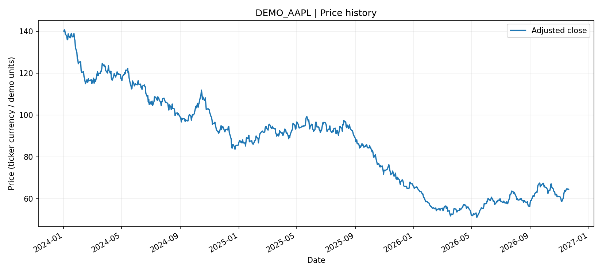
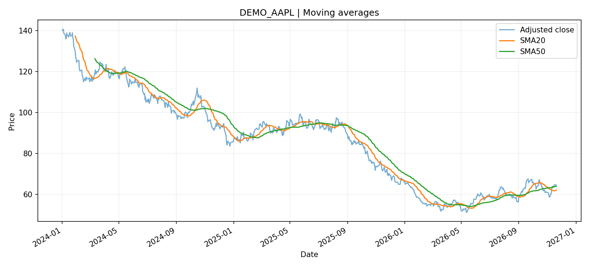
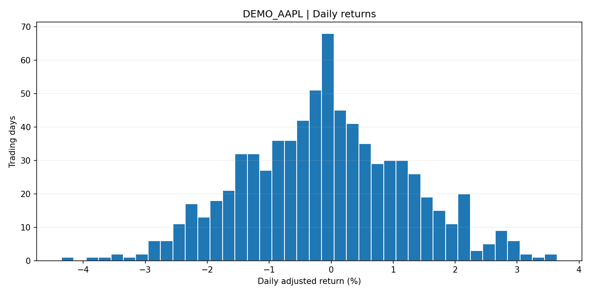

# Stock Market Data Analyzer 📈

**End-to-end, beginner-friendly, GitHub-ready Python finance/data analysis project.**

Analyze **synthetic sample stock prices offline**, your own OHLCV CSV files, or Yahoo Finance historical data. Generate visualizations, technical indicators, a Markdown report, and a reproducible educational SMA backtest. Use the **Streamlit dashboard** first; explore the **FastAPI + Next.js dashboard** as an advanced extension.

> **Important:** `DEMO_AAPL`, `DEMO_NVDA`, and `DEMO_RELIANCE` are synthetic data for virtual simulation. They are **not** Apple, NVIDIA or Reliance stock prices. No orders are placed. This project is **for education only, not financial advice**.

## Gallery: authentic demo charts

These PNG files are produced automatically by `python main.py` from the included synthetic data.







## Problem statement

Manual price comparison in spreadsheets can be repetitive and inconsistent. This project creates a repeatable workflow to obtain daily OHLCV data, remove corrupt rows, compute price and historical risk measurements, visualize trends, and compare a simple simulated rule with buy-and-hold. It shows how finance/FinTech teams prototype data pipelines, research tools and backtest workflows; professional trading systems require much stronger quality controls, risk management and data licensing.

## Features

- Offline demo **works without accounts, API keys or external data access** after package installation.
- Optional historical Yahoo Finance download (for example `AAPL`, `MSFT`, `RELIANCE.NS`, `TCS.NS`).
- CSV input fallback with Open, High, Low, Close, adjusted Close (optional), Volume and Date.
- Validation, duplicate/invalid-row cleaning and no fabricated forward-filled price history.
- SMA20, SMA50, RSI14 (Wilder), MACD, Bollinger Bands and crossovers.
- Adjusted daily return, mean return, annualized historical volatility, raw high and low.
- Three printable Matplotlib PNG charts; analyzed CSV, Markdown and JSON reports.
- Long-only **SMA20/50 delayed-signal backtest** with fees/slippage, max drawdown, Sharpe and closed-trade win rate.
- SQLite storage for candles, indicators, watchlists, paper buys/sells, backtest results and local alert events.
- Streamlit Python dashboard; optional FastAPI JSON API and Next.js + Recharts web dashboard.
- Offline pytest unit/API tests and GitHub Actions CI.

## Run it in three beginner steps (Windows)

1. Unzip the repository and open the `Stock-Market-Data-Analyzer` folder.
2. Install Python 3.11 or 3.12 from <https://www.python.org/downloads/windows/> and choose the **Add Python to PATH** option if shown.
3. Double-click **`start_windows.bat`**. The first run installs free packages, then analyzes the offline demo. Double-click **`dashboard_windows.bat`** to open Streamlit in your browser.

**If Python was not found**, read the detailed fix in [`START_HERE.txt`](START_HERE.txt).

### Manual quick start (all platforms)

```bash
python -m venv .venv
# Windows: .venv\Scripts\activate
# macOS/Linux: source .venv/bin/activate
python -m pip install -r requirements.txt
python main.py
python -m streamlit run dashboard.py
```

The sample runs entirely offline once dependencies have been installed. The dashboard appears at <http://localhost:8501>.

### Fetch Yahoo Finance historical data

```bash
python main.py --source yahoo --ticker AAPL --start 2024-01-01
python main.py --source yahoo --ticker RELIANCE.NS --start 2024-01-01
```

**Not a live market-data service:** Yahoo market history may be delayed, missing, restricted or unavailable. These requests need internet. The tool does not provide guaranteed real-time prices.

### Load your CSV

Put your own file in `data/imports/` and run:

```bash
python main.py --source csv --file data/imports/my_prices.csv --ticker MY_STOCK
```

Minimal columns: `Date,Open,High,Low,Close,Volume`; `Adj Close` optional. At least 55 valid daily rows are needed.

### Test the project

```bash
python -m pip install -r requirements-dev.txt
python -m pytest -q
```

## Architecture

```text
CSV / Yahoo / DEMO  --->  Clean + validate daily OHLCV
                                 |
                                 v
                   Indicators + Return / Volatility
                                 |
                    +------------+------------+
                    |            |            |
             SQLite storage  PNG & CSV   Strategy backtest
                    |            |            |
         +----------+            +-----+------+
         |                             |
   FastAPI endpoints             Markdown/JSON report
         |
  Optional Next.js

      Streamlit UI uses the same Python analytics + SQLite layer
```

## Example demo output (synthetic, not real-market results)

```text
SUCCESS | DEMO_AAPL | sample | 754 rows
Dates: 2024-01-02 to 2026-11-20
Price change: -53.87%
Annualized volatility: 20.90%
Backtest return: -39.28% | Buy & hold: -45.88%
```

Your full results are saved in:

- [`outputs/DEMO_AAPL_analysis.csv`](outputs/DEMO_AAPL_analysis.csv) — indicators and returns per trading day.
- [`outputs/charts/`](outputs/charts) — actual price, SMA and daily return charts.
- [`reports/DEMO_AAPL_report.md`](reports/DEMO_AAPL_report.md) — explanatory research report.
- [`reports/DEMO_AAPL_summary.json`](reports/DEMO_AAPL_summary.json) — metrics suitable for analysis or parsing.

Synthetic prices use arbitrary demonstration units. The example is repeatable but **not evidence of any actual stock's performance**.

## Technology and industry relevance

| Layer | Technology | Purpose |
|---|---|---|
| Core | Python, Pandas, NumPy | Cleaning and calculations |
| Data | CSV, yfinance | Offline fallback and public historical feed |
| Charts | Matplotlib, Plotly, Recharts | Static and interactive visuals |
| Database | SQLite | Repeatable ticker/date analytics and paper portfolio |
| Backend | FastAPI, Uvicorn | REST endpoints |
| Interfaces | Streamlit; optional Next.js + TypeScript | Beginner and advanced dashboards |
| Testing | pytest, httpx, GitHub Actions | Quality checks |

Roles relevant to this proof of work: Python Developer, Data Analyst, Financial Analyst, FinTech Engineer and Business Analyst. This is an educational project, not a production-grade market-risk system.

## Optional: FastAPI + Next.js

**Backend**, from the project root:

```bash
python -m uvicorn api.app:app --host 127.0.0.1 --port 8000
```

- API documentation: <http://127.0.0.1:8000/docs>
- Health check: <http://127.0.0.1:8000/health>
- Example historical data: <http://127.0.0.1:8000/chart/DEMO_AAPL>

**Web UI**, after installing Node.js 20.9+, in another terminal:

```bash
cd apps/web
npm install
npm run dev
```

Open <http://127.0.0.1:3000>. The Next.js local proxy forwards `/api/` calls to the FastAPI service.

The API is intentionally **not authenticated** and must be kept on localhost unless proper security is implemented.

## Folder structure

```text
Stock-Market-Data-Analyzer/
├── main.py                    # Analyze, plot, save CSV/report
├── dashboard.py               # Streamlit UI
├── start_windows.bat          # Easy Windows setup
├── dashboard_windows.bat      # Start dashboard on Windows
├── START_HERE.txt             # Extra-easy instructions
├── src/                       # Data, indicators, backtest, storage, charts, reports
├── api/app.py                 # FastAPI endpoints
├── apps/web/                  # Optional Next.js dashboard
├── data/sample/               # Synthetic CSVs (3 demonstration tickers)
├── data/imports/              # Personal local CSVs (ignored by Git)
├── db/schema.sql              # SQLite schema
├── jobs/alerts.py             # On-demand alert check
├── outputs/                    # Generated analysis CSV and PNG charts
├── reports/                    # Markdown and JSON research output
├── tests/                      # Offline unit + API tests
├── notebooks/                  # Optional experiments
├── images/                     # Instructions for personal screenshots
├── docs/                       # Complete guide, interview Q&A and GitHub upload
├── .github/workflows/test.yml # CI
├── requirements.txt
└── .gitignore
```

## Tutorial, proof-of-work and interview preparation

- **[`docs/PROJECT_GUIDE.md`](docs/PROJECT_GUIDE.md)** — explanation, three stack options, architecture, every implementation phase, simulation, six-day proof plan and screenshot details.
- **[`docs/GITHUB_UPLOAD_FOR_BEGINNERS.md`](docs/GITHUB_UPLOAD_FOR_BEGINNERS.md)** — screenshot-friendly GitHub website and terminal upload paths.
- **[`docs/INTERVIEW_PREPARATION.md`](docs/INTERVIEW_PREPARATION.md)** — 10 essential questions and answers, plus HR and technical introductions.
- **[`images/SCREENSHOT_CHECKLIST.md`](images/SCREENSHOT_CHECKLIST.md)** — precisely what to capture for GitHub proof.

## Limits, assumptions and disclaimer

Backtesting assumes daily close-to-close adjusted returns, 252 trading days per year and 0% risk-free rate for Sharpe; positions use yesterday's signal to reduce look-ahead. Fees and slippage are estimates. Missing trade-price execution details, bid/ask spreads, intraday fills, taxes, corporate-action reconciliation, borrowing, market impact and survivorship/selection bias mean this is **not suitable for real trading**. Alerts check only the latest saved row when explicitly requested and do not send emails.

**For education and research only. This is not financial advice, and past performance (including simulations) does not guarantee future results.**
